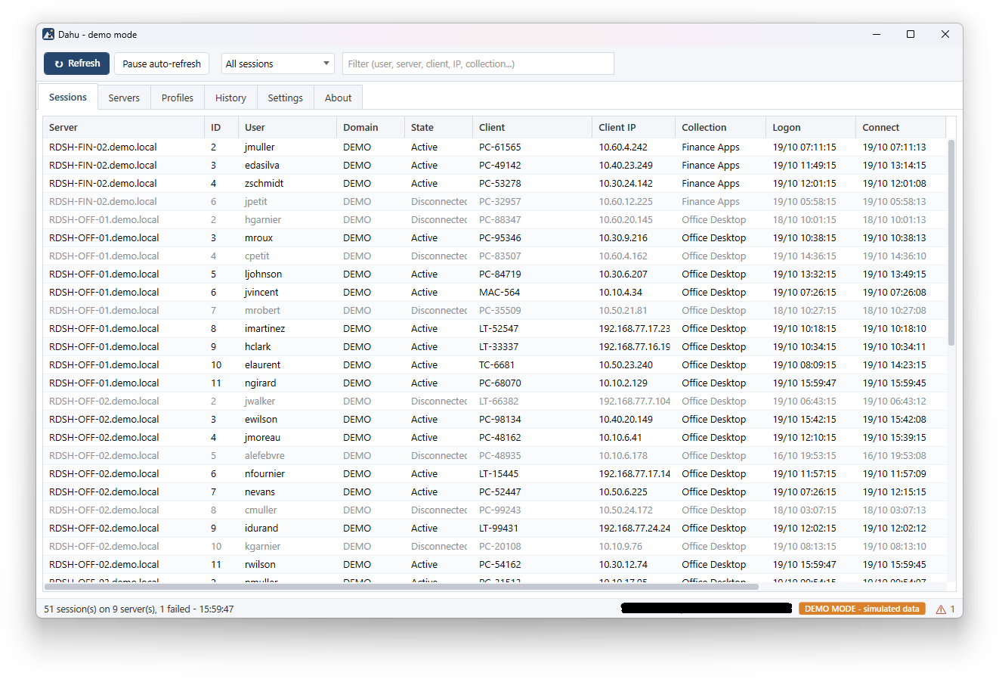
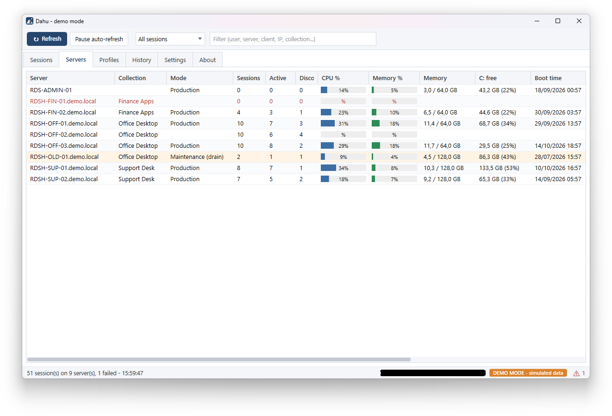

# Dahu

Administration tool for Windows Server RDS (Remote Desktop Services) farms.
A lightweight alternative to tools like TSAdmin or Galinette Cendrée: view the sessions, servers and profiles of a farm, and act on them.

Single `Dahu.exe` file, no installation, no runtime to deploy.

<p align="center">
  <a href="img/sessions.png"></a>
  <br>
  <a href="img/servers.png"></a>
  <a href="img/about.png"></a>
</p>

## Features

- **Sessions**: every session in the farm, with filtering, sorting and multi-selection.
  Right-click: details, processes, shadow, message, disconnect, log off, Active Directory card.
- **Servers**: hosts discovered through the Broker or declared manually, load, sessions, maintenance mode.
  Right-click: processes, message to all, restart, shutdown, mstsc, C$ share.
- **Profiles**: inventory of UPD and FSLogix disks, user resolved from the SID, size, mounted state.
- **History**: session logons and logoffs read from each server's event log.
- **Settings**: brokers, hosts, profile shares, timeouts, language, theme, columns, alternate account.

Interface available in English and French.

## Requirements

- Windows 10 / 11 or Windows Server 2016 and later, 64-bit. The .NET runtime is embedded: nothing to install.
- An account that is a local administrator on the session hosts (and on the Connection Broker, if used). Out-of-domain workstations can use the alternate account option in Settings.
- Network access from the workstation to each server: TCP 445 (sessions, shadow, C$) and TCP 135 plus RPC dynamic ports (WMI, event log, broker queries).
- Profiles tab only: read access to the UPD / FSLogix shares.

## Build

```powershell
.\build.ps1
.\build.ps1 -Debug
```

The script installs the .NET 10 SDK into `%USERPROFILE%\.dotnet` if missing, without administrator rights.
